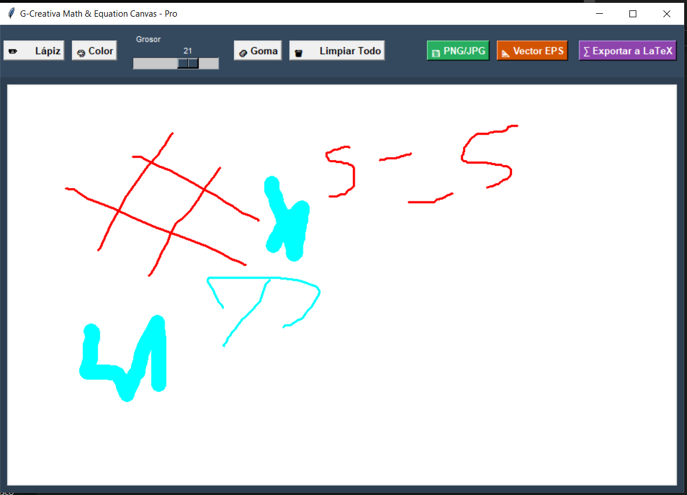

# ✍️ G-Creativa Math Canvas Editor




Una pizarra digital de alta fidelidad desarrollada en Python por [gcreativaa](https://github.com/gcreativaa), diseñada específicamente para matemáticos, físicos y artistas técnicos. Permite escribir ecuaciones complejas a mano y exportarlas a formatos rasterizados o vectores matemáticos puros para publicaciones científicas.

## 🧬 Capacidades del Software

*   **Lienzo Fluido (Anti-aliased):** Renderizado de trazos suaves mediante interpolación de coordenadas para simular escritura real.
*   **Exportación Vectorial Científica (EPS):** Exporta tus fórmulas directamente a un formato vectorial (Encapsulated PostScript). A diferencia de los JPG/PNG, este archivo no tiene píxeles, lo que permite escalarlo a tamaños infinitos sin perder calidad. Es el formato estándar soportado nativamente por compiladores **LaTeX**.
*   **Doble Renderizado en Memoria:** El software dibuja simultáneamente en la interfaz de usuario (Tkinter) y en un buffer de memoria de alta resolución (Pillow) para garantizar exportaciones PNG/JPG nítidas.
*   **Arquitectura IA-Ready:** Estructura modular preparada para integrar APIs de reconocimiento óptico de caracteres (OCR) para conversión directa a código `.tex`.

## ⚙️ Instalación y Uso

Desarrollado en Python 3.14.00. Requiere la biblioteca gráfica `Pillow`.

1. Clona el repositorio:
   ```bash
   git clone [https://github.com/gcreativaa/math-canvas-editor.git](https://github.com/gcreativaa/math-canvas-editor.git)

   Accede a la carpeta:

Bash
cd math-canvas-editor
Instala los requerimientos de procesamiento de imagen:

Bash
pip install Pillow
Ejecuta el lienzo digital:

Bash
python math_canvas.py
📐 Cómo usar en tus documentos LaTeX
Dibuja tu ecuación.

Haz clic en Guardar Vector (EPS/SVG).

En tu documento LaTeX, inclúyelo fácilmente manteniendo la calidad absoluta:

Fragmento de código
\usepackage{graphicx}
\begin{figure}[h]
    \centering
    \includegraphics[width=0.8\textwidth]{tu_ecuacion.eps}
\end{figure}
💖 Patrocina el Desarrollo
Esta herramienta es gratuita y de código abierto. Si la utilizas para ilustrar tus papers científicos, apuntes universitarios o proyectos de desarrollo, considera invitarme un café. Tu apoyo financia la investigación y creación de nuevas herramientas.

☕ Donaciones directas vía PayPal:

👉 herrerabarragan.guadalupe@gmail.com

Ingeniería visual y lógica por gcreativaa.